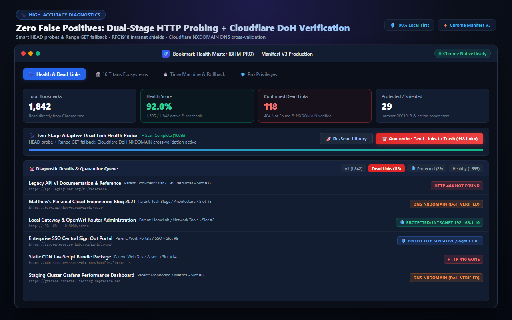
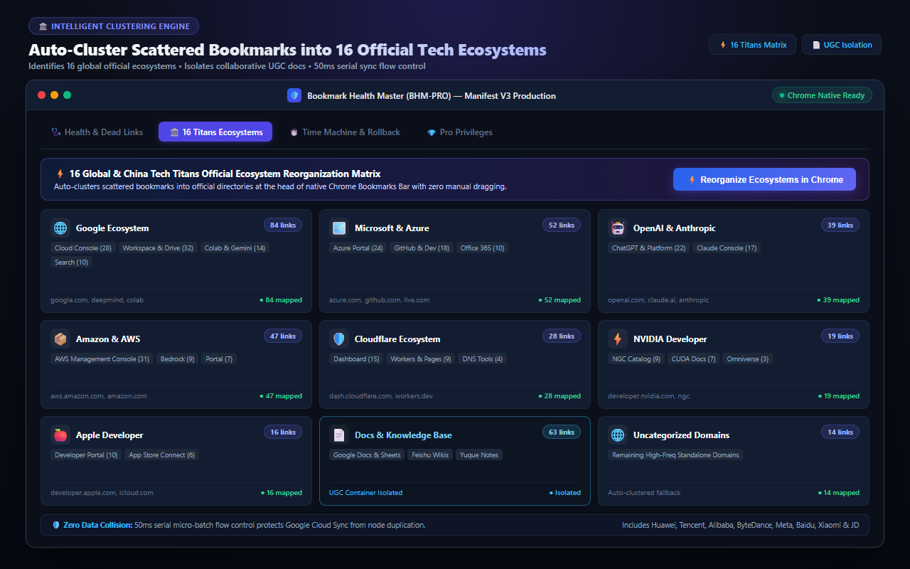
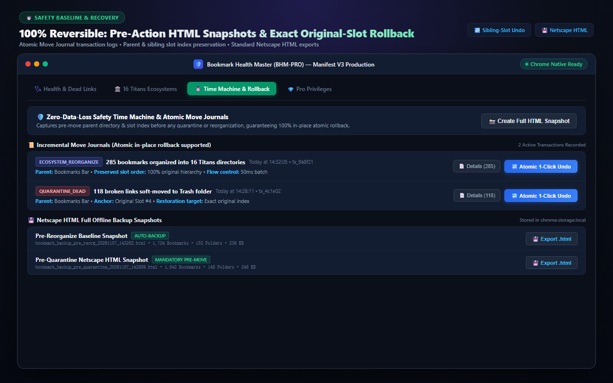
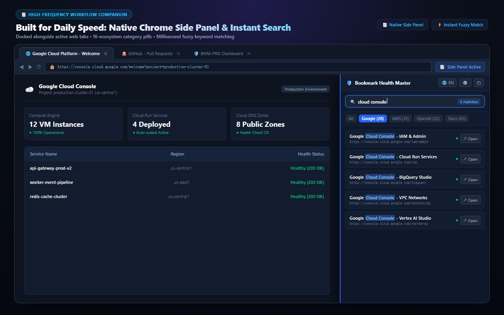

# Bookmark Health Master (BHM-PRO)

<p align="center">
  
</p>

<h3 align="center">Resurrect Your Bookmarks. Zero 404s. Zero Telemetry.</h3>

<p align="center">
  A high-performance, local-first Chrome Extension (Manifest V3) that eliminates dead bookmarks with Dual-Stage DNS-over-HTTPS (DoH) verification, organizes sprawling links into 16 Tech Titan ecosystems, and provides atomic sibling-anchor rollback with 100% position fidelity.
</p>

<p align="center">
  <a href="https://chromewebstore.google.com/detail/nomieaphhhhhikklfhmhhjcdgicaikgn"></a>
  <a href="https://github.com/qq136692547-cmyk/bookmark-health-master/releases"></a>
  <a href="LICENSE"></a>
  <a href="#"></a>
  <a href="SECURITY.md"></a>
  <a href="#"></a>
</p>

<p align="center">
  <a href="https://chromewebstore.google.com/detail/nomieaphhhhhikklfhmhhjcdgicaikgn">
    
  </a>
  &nbsp;&nbsp;
  <a href="https://bhm-pro-ern.pages.dev/">
    
  </a>
</p>

---

## ⚡ The Problem BHM-PRO Solves

Most bookmark cleaners rely on naive HTTP scrapers that break:
- **False Positives**: Cloudflare, Akamai, and bot protection return HTTP 403/503 for normal scrapers, causing tools to falsely delete alive links.
- **SSRF & Intranet Hazards**: Naive scrapers hammer internal IP addresses (`192.168.x.x`, `10.x.x.x`, `localhost`), triggering routers or internal services.
- **Destructive Deletions**: Deleting bookmarks is usually permanent; restoring via browser sync causes index order loss and folder disorder.
- **Privacy Invasive**: Many bookmark managers require cloud accounts and beam your entire browsing catalog to remote analytical servers.

**Bookmark Health Master fixes all of this** through an open-core, local-first engine with military-grade safety.

---

## ✨ Key Features & Visual Walkthrough

### 1. Dual-Stage Dead Link Diagnostics (DoH NXDOMAIN)
Traditional cleaners mistake Cloudflare WAF anti-crawler challenges (HTTP 403 / 503) for dead links. BHM-PRO uses an intelligent dual-stage probe: if HTTP fails, it falls back to **DNS-over-HTTPS (DoH)** via Cloudflare `1.1.1.1` and Google `8.8.8.8` to query the authorative DNS status. A link is only marked **DEAD** when DNS confirms `NXDOMAIN` (domain deregistered or abandoned), eliminating false deletions.

<p align="center">
  
</p>

### 2. 16 Tech Titans Ecosystem Auto-Clustering
Automatically groups disorganized bookmarks across 16 global technology giants into dedicated branded hierarchies, while cleanly isolating sub-domains (e.g. AWS Cloud, Google Cloud, Microsoft Azure, Meta AI, OpenAI, Cloudflare, NVIDIA, Apple Developer).

<p align="center">
  
</p>

### 3. UGC Collaborative Docs Smart Isolation
Smartly shields collaborative document URLs (Google Docs, Sheets, Slides, Notion, Feishu/Lark docx/wiki, Figma) from being swallowed by broad domain matching, keeping active team documents categorized into a dedicated UGC workspace.

### 4. Sibling-Anchor Time-Machine Rollback
Every movement and quarantine is recorded in an append-only `MoveJournal`. If you ever want to revert, BHM-PRO reverses the log in exact ascending order, restoring bookmarks to their precise previous folders and relative indices with 0 shifts, 0 drops, and 0 duplicates.

<p align="center">
  
</p>

### 5. Native Chrome SidePanel & Deep Workspace
Work directly alongside your active tab with the native Chrome SidePanel, or expand into the full-screen Diagnostic Dashboard for deep inspection of 10,000+ bookmark collections.

<p align="center">
  
</p>

---

## 🏗️ Technical Architecture

```
                                  +-------------------------------------------------+
                                  |         Chrome Browser Local Sandbox            |
                                  |           (Manifest V3 Service Worker)          |
                                  +-----------------------+-------------------------+
                                                          |
                                      +-------------------+-------------------+
                                      |                                       |
                         [ chrome.bookmarks API ]               [ chrome.storage.local ]
                                      |                                       |
                   +------------------v------------------+       +------------v------------+
                   |       SafetyManager Engine          |       |   Ed25519 WebCrypto     |
                   | - Netscape HTML Backup Snapshot     |       | - 100% Offline Verifier |
                   | - Sibling-Anchor Move Journal       |       | - Zero Telemetry Daemon |
                   +------------------+------------------+       +-------------------------+
                                      |
                     +----------------+----------------+
                     |                                 |
         +-----------v-------------+       +-----------v-------------+
         | EcosystemClassifier     |       |   BookmarkProber        |
         | - 16 Tech Titans Trees  |       | - RFC 1918 SSRF Shield  |
         | - UGC Docs Shield       |       | - Stream Cancellation   |
         | - Domain Bucketing      |       | - DNR Referer Stripping |
         +-------------------------+       +-----------+-------------+
                                                       |
                                        [ HTTP Probe Fails / 403 / 503 ]
                                                       |
                                           +-----------v-------------+
                                           |  DoH Engine (Stage 2)   |
                                           |  Cloudflare 1.1.1.1     |
                                           |  Google 8.8.8.8         |
                                           |  NXDOMAIN Verified DEAD |
                                           +-------------------------+
```

### Architectural Highlights
1. **RFC 1918 & Intranet Shielding**: Explicitly filters private IPs (`10.0.0.0/8`, `172.16.0.0/12`, `192.168.0.0/16`, `127.0.0.0/8`, `localhost`) and pseudo-schemes (`javascript:`, `chrome:`, `file:`) before outbound fetches.
2. **DeclarativeNetRequest Session Isolation**: Dynamically installs ephemeral rules to strip `Origin` and `Referer` headers on probe fetches, preventing information leakage to checked websites.
3. **Pure Stream Cancellation**: Fetch calls cancel streaming bodies immediately upon receiving response headers, saving network bandwidth.
4. **Offline Ed25519 Verification**: Public key `crypto.subtle.verify()` validates digital signatures locally without remote pings.

---

## 📊 Feature Comparison Matrix (Open-Core Strategy)

| Feature | Community Edition (Free) | Single Wash Pass ($9.90) | BHM-PRO Lifetime Buyout ($24.90) |
| :--- | :---: | :---: | :---: |
| **Dead Link Prober (HTTP Stage 1)** | ✅ Up to 100 Links | ✅ Up to 500 Links | 🚀 **Unlimited Forever** |
| **DNS-over-HTTPS (DoH) Deep NXDOMAIN** | ✅ Full Access | ✅ Full Access | 🚀 **Unlimited Forever** |
| **RFC 1918 Intranet SSRF Shield** | ✅ Included | ✅ Included | 🚀 **Included** |
| **DNR Origin & Referer Stripping** | ✅ Included | ✅ Included | 🚀 **Included** |
| **Netscape HTML Full Tree Export Backup** | ✅ Included | ✅ Included | 🚀 **Included** |
| **Sibling-Anchor Move Journal Undo** | ✅ Last 5 Actions | ✅ 30 Days History | 🚀 **Unlimited Perpetual History** |
| **16 Tech Titans Auto-Clustering** | ⚠️ Preview Only | ✅ 30 Days Access | 🚀 **Full Uncapped Engine** |
| **UGC Docs Protective Isolation** | ✅ Included | ✅ Included | 🚀 **Included** |
| **Native Chrome SidePanel Integration** | ✅ Included | ✅ Included | 🚀 **Included** |
| **Cloud Telemetry & Privacy Tracking** | ❌ **Zero (100% Local)** | ❌ **Zero (100% Local)** | ❌ **Zero (100% Local)** |
| **License Verification Method** | Open Source | 100% Offline Ed25519 | 100% Offline Ed25519 |
| **Price** | **Free (MIT License)** | **$9.90 (30-day pass)** | **$24.90 (One-Time Buyout)** |

👉 Upgrade to BHM-PRO Lifetime Buyout: **[https://bhm-pro-ern.pages.dev/](https://bhm-pro-ern.pages.dev/)**

---

## 🛠️ Developer Local Build & Load Instructions

You can build and test Bookmark Health Master directly from source in under 60 seconds.

### 1. Clone the Repository
```bash
git clone https://github.com/qq136692547-cmyk/bookmark-health-master.git
cd bookmark-health-master
```

### 2. Run the Verification & Regression Suite
The test runner has zero npm dependencies and runs on native Node.js (v18+):
```bash
node tests/run_all_tests.js
```
Expected output:
```
Total Suites: 15 | Passed: 15 | Failed: 0
🎉 ALL 4 TIERS OF E2E TESTS PASSED WITH 100% SUCCESS RATE!
```

### 3. Load into Google Chrome
1. Open Google Chrome and visit `chrome://extensions/`.
2. Turn ON **Developer mode** (top-right toggle switch).
3. Click the **Load unpacked** button.
4. Select the `bookmark-organizer/` folder inside this repository.
5. The extension will load instantly. Click the extension icon or open Chrome's SidePanel to start using it.

---

## 🔒 Security & Privacy Guarantee

- **Zero Remote Storage**: Your bookmarks are never transmitted, stored, or indexed on external servers.
- **No Third-Party Analytics**: No Google Analytics, Segment, Sentry, or trackers exist in the extension code.
- **Full Security Audit Documentation**: See [`SECURITY.md`](SECURITY.md) for full architectural disclosures.

---

## 🤝 Contributing

We welcome community pull requests, bug fixes, and new ecosystem clustering rules! Please review our [`CONTRIBUTING.md`](CONTRIBUTING.md) guide before submitting a PR.

---

## 📄 License

This repository is distributed under the **MIT License**. See the [`LICENSE`](LICENSE) file for complete details.

---

<p align="center">
  Crafted with care by the <b>BHM-PRO Team / L.D. Studio (2026)</b><br>
  Official Landing Page: <a href="https://bhm-pro-ern.pages.dev/">https://bhm-pro-ern.pages.dev/</a> &bull; Chrome Web Store: <a href="https://chromewebstore.google.com/detail/nomieaphhhhhikklfhmhhjcdgicaikgn">Add to Chrome</a>
</p>
